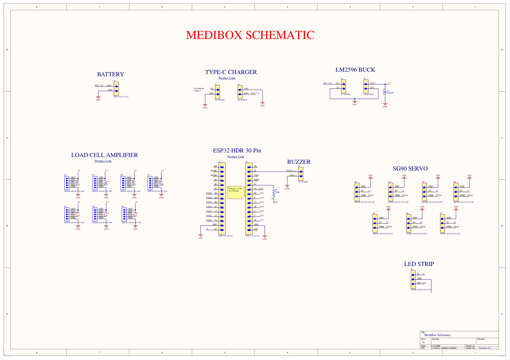

# Medibox dispenser and wearable companion

Hardware designs for a seven-compartment medication dispenser and a wearable reminder device. The base board connects an ESP32 controller to servo and weight-sensing interfaces. The wearable uses an ESP32-S3 module, battery charger and vibration-motor driver.

## Project status

Altium schematics, PCB layouts, fabrication outputs and supporting documents are included. The uploaded DRC reports record zero violations for both boards under their configured rules. Firmware and end-to-end system measurements are not included here.

## My contribution

I designed the boards from schematic capture through component selection, placement, routing and preparation of fabrication outputs in Altium Designer.

## Hardware architecture

| Subsystem | PCB | Interfaces |
| --- | --- | --- |
| Medibox base | Two layers | Servo PWM, HX711 clock/data, LED strip and buzzer |
| Wearable companion | Four layers | USB-C, charging, power selection, motor driver and peripheral FPC connector |

Wireless coordination and sensor-based dispensing checks are intended system functions. The repository documents the electronics rather than a demonstrated complete medication-management system.

## Medibox base board

- Seven servo connectors for dispensing actuation.
- Seven HX711 module interfaces with a shared clock and separate data connections.
- Connections for an LM2596 regulator module and bulk capacitance on the supply bus.
- LED-strip and buzzer interfaces for reminders.
- Wider routing rules for power nets than for general signals.

Bulk capacitance and wider power routing support the intended servo loads. Supply droop, simultaneous-servo demand and thermal behavior need load testing. Weight-sensing interfaces provide a basis for dispensing detection; detection accuracy requires system testing.

### Schematic

[Open schematic PDF](MediBox-Base-Dispenser/Documentation/medibox_schematic.pdf)

## Wearable companion

| Function | Components |
| --- | --- |
| Controller | ESP32-S3-MINI-1-N8 |
| Battery charging | MCP73831 single-cell charger |
| Power selection | DMG2305UX MOSFET and MBR0520 Schottky diode |
| Regulation | AP2112K 3.3 V regulator |
| Haptic output | SI2302 switching circuit with flyback diode |
| Peripheral connection | Four-pin FPC connector |

The power-selection circuit is intended to support USB and battery operation. Switching behavior, charging under load and battery-voltage headroom need hardware verification. The peripheral connector does not by itself establish sensor or display integration.

## Design files

| Files | Medibox base | Wearable |
| --- | --- | --- |
| Altium source | [Hardware](MediBox-Base-Dispenser/Hardware/) | [Hardware](Wearable-Companion/Hardware/) |
| Fabrication outputs | [Gerbers and drill](MediBox-Base-Dispenser/Fabrication/) | [Gerbers and drill](Wearable-Companion/Fabrication/) |
| DRC | [Base report](MediBox-Base-Dispenser/Fabrication/Design_Rule_Check.drc) | [Wearable report](Wearable-Companion/Fabrication/Design_Rule_Check.drc) |
| Documentation | [Schematic](MediBox-Base-Dispenser/Documentation/) | [BOM](Wearable-Companion/Documentation/Wearable_Bill_of_Materials.pdf) |

## Next steps

Bring up supply rails, servo outputs, weight-sensor communication, charging and the vibration driver. Follow with system tests for dispensing detection and wireless reminders.

## Author

[Aakashdip Dey](https://github.com/AakashdipDey)
